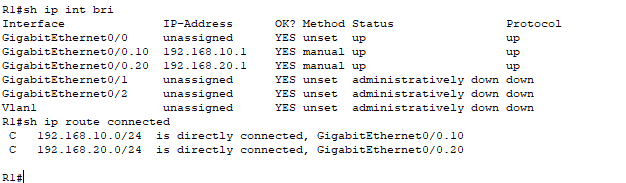
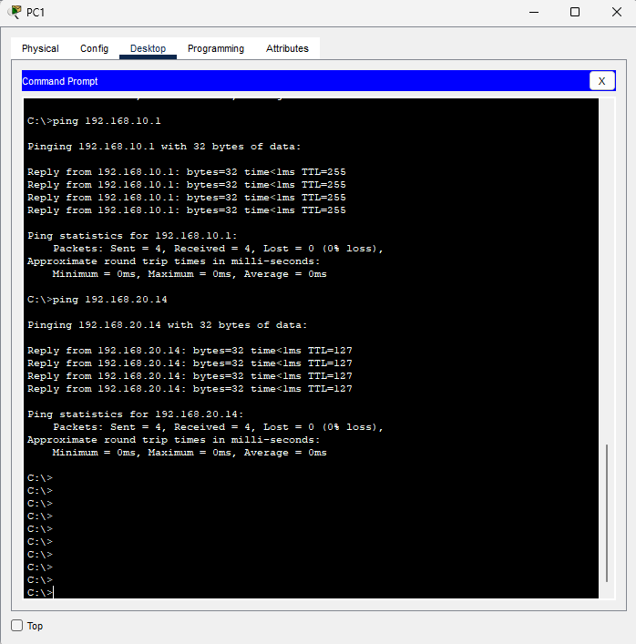
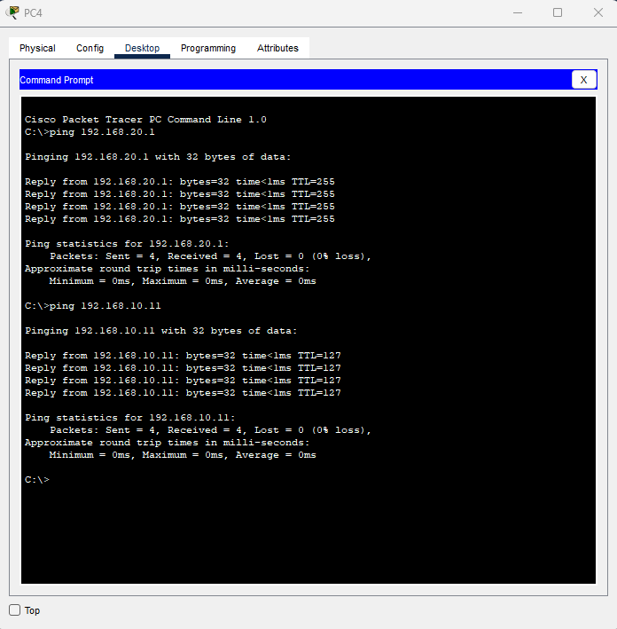
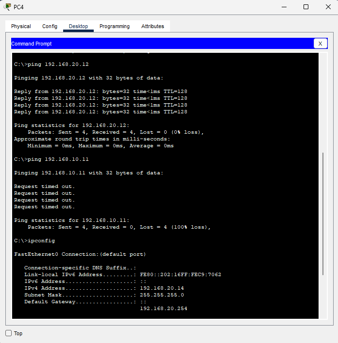
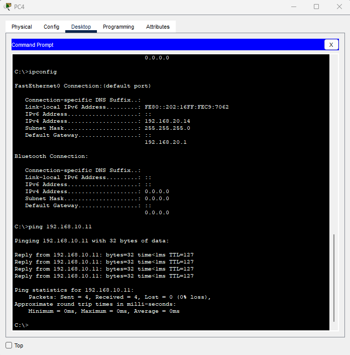

# Inter-VLAN Routing and Default Gateway Troubleshooting

Configured router-on-a-stick routing between VLANs 10 and 20 in Cisco Packet Tracer. A deliberately incorrect default gateway on PC4 broke communication with another subnet while same-VLAN communication continued working. Restoring the correct gateway recovered inter-VLAN connectivity.

## Environment

This project builds on the completed VLAN trunk troubleshooting lab: two Cisco 2960 switches, four PCs, and an added Cisco 2911 router named R1.

| Connection | Ports |
| --- | --- |
| PC1 → SW1 | FastEthernet0 → Fa0/1, access VLAN 10 |
| PC2 → SW1 | FastEthernet0 → Fa0/2, access VLAN 20 |
| PC3 → SW2 | FastEthernet0 → Fa0/1, access VLAN 10 |
| PC4 → SW2 | FastEthernet0 → Fa0/2, access VLAN 20 |
| SW1 → SW2 | G0/1 → G0/1, trunk allowing VLANs 10,20 |
| R1 → SW1 | G0/0 → G0/2, router-on-a-stick trunk |

| Host | VLAN | IP address | Mask | Correct gateway |
| --- | --- | --- | --- | --- |
| PC1 | 10 — USERS | 192.168.10.11 | 255.255.255.0 | 192.168.10.1 |
| PC3 | 10 — USERS | 192.168.10.13 | 255.255.255.0 | 192.168.10.1 |
| PC2 | 20 — SERVERS | 192.168.20.12 | 255.255.255.0 | 192.168.20.1 |
| PC4 | 20 — SERVERS | 192.168.20.14 | 255.255.255.0 | 192.168.20.1 |

SERVERS is the VLAN name; VLAN 20 endpoints are PCs in this exercise.

## Objectives

- Configure an 802.1Q trunk from a switch to a router.
- Create router subinterfaces as VLAN gateways.
- Verify connected routes and communication between subnets.
- Compare local and remote connectivity to isolate a host gateway fault.
- Correct the gateway and verify recovery.

## 1. Configure the router-facing trunk

R1 G0/0 was connected to SW1 G0/2 using a copper straight-through cable.

On SW1:

```text
enable
configure terminal
interface gigabitEthernet0/2
description TRUNK-TO-R1
switchport mode trunk
switchport trunk allowed vlan 10,20
end
```

The existing SW1–SW2 trunk and access VLAN assignments were retained.

## 2. Configure router-on-a-stick

On R1:

```text
enable
configure terminal
hostname R1
interface gigabitEthernet0/0
description TRUNK-TO-SW1
no shutdown
exit
interface gigabitEthernet0/0.10
description GATEWAY-VLAN10-USERS
encapsulation dot1Q 10
ip address 192.168.10.1 255.255.255.0
exit
interface gigabitEthernet0/0.20
description GATEWAY-VLAN20-SERVERS
encapsulation dot1Q 20
ip address 192.168.20.1 255.255.255.0
end
show ip interface brief
show ip route connected
```

The physical interface had no IP address. Each subinterface associated an 802.1Q VLAN ID with that VLAN's gateway address.

Verification showed both subinterfaces up/up and these connected networks:

| Network | Router interface |
| --- | --- |
| 192.168.10.0/24 | GigabitEthernet0/0.10 |
| 192.168.20.0/24 | GigabitEthernet0/0.20 |

No dynamic routing protocol was required for R1 to route between these directly connected networks.



## 3. Configure host gateways and establish a baseline

Each PC's default gateway was set using Desktop → IP Configuration, retaining its existing IP address and subnet mask.

From PC1:

```text
ping 192.168.10.1
ping 192.168.20.14
```

Both its gateway and PC4 replied to all four requests.



From PC4:

```text
ping 192.168.20.1
ping 192.168.10.11
```

Both its gateway and PC1 replied to all four requests. Each captured baseline test showed 0% loss.



## 4. Introduce and diagnose a wrong gateway

Only PC4's default gateway was changed, from `192.168.20.1` to `192.168.20.254`. Its address and mask remained unchanged.

On PC4:

```text
ping 192.168.20.12
ping 192.168.10.11
ipconfig
```

| Check | Fault-state result |
| --- | --- |
| PC4 → PC2, same subnet | 4/4 replies, 0% loss |
| PC4 → PC1, different subnet | 0/4 replies, 100% loss |
| PC4 IPv4 address | 192.168.20.14 |
| PC4 subnet mask | 255.255.255.0 |
| PC4 default gateway | 192.168.20.254 — incorrect |

The successful local test showed PC4 could still communicate within VLAN 20 across the switches. The failed remote test and incorrect gateway in `ipconfig` identified a host configuration problem rather than requiring a change to the router's connected routes.

A host sends traffic directly to destinations in its own subnet. To reach a different subnet, PC4 needed the actual router gateway, 192.168.20.1. The configured .254 address was not the gateway provided by this topology.



## 5. Correct and verify

PC4's gateway was restored to `192.168.20.1` using Desktop → IP Configuration.

```text
ipconfig
ping 192.168.10.11
```

The output confirmed the correct gateway, and PC4 reached PC1 with four of four replies and 0% loss. No switch or router configuration change was needed to resolve the deliberately introduced fault.



## Results

| Stage | PC4 gateway | PC4 → PC2, same VLAN | PC4 → PC1, different VLAN |
| --- | --- | --- | --- |
| Working baseline | 192.168.20.1 | Not separately captured in this stage | 4/4 replies |
| Fault | 192.168.20.254 | 4/4 replies | 0/4 replies |
| Recovery | 192.168.20.1 | Not repeated in this stage | 4/4 replies |

R1, SW1, and SW2 configurations were saved using:

```text
copy running-config startup-config
```

The Packet Tracer project, including PC settings, was also saved.

## Lessons and scope

- Router-on-a-stick uses one physical link with VLAN-tagged subinterfaces to route between VLANs.
- An up/up subinterface and a connected route are useful checks, but end-to-end tests are still needed to verify host communication.
- Working same-subnet communication combined with failed remote communication is a reason to inspect the host's mask and gateway, alongside the wider routing path.
- This exercise tested ICMP connectivity and one incorrect host gateway. It did not test every host pair, a subinterface tagging fault, DHCP, internet access, or routing redundancy.
- No ACL or firewall policy was added. Enabling inter-VLAN routing provides connectivity; access restrictions require a separate policy configuration.
- No packet capture or uninterrupted-session measurement was performed.

## Project file

[Download the Packet Tracer lab](inter-vlan-routing-troubleshooting.pkt)
